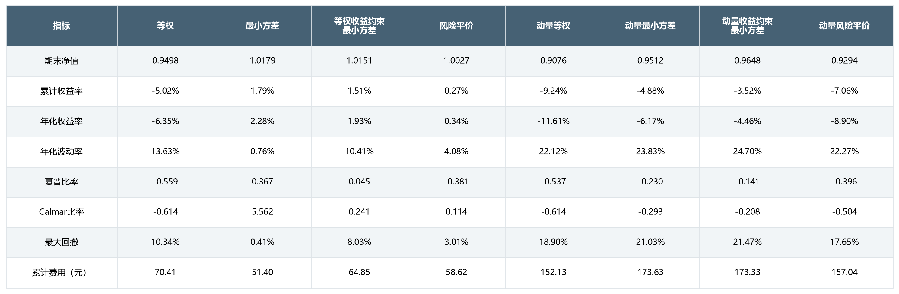
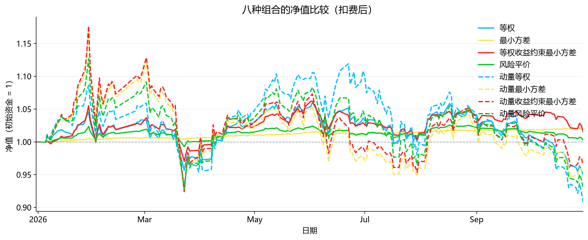
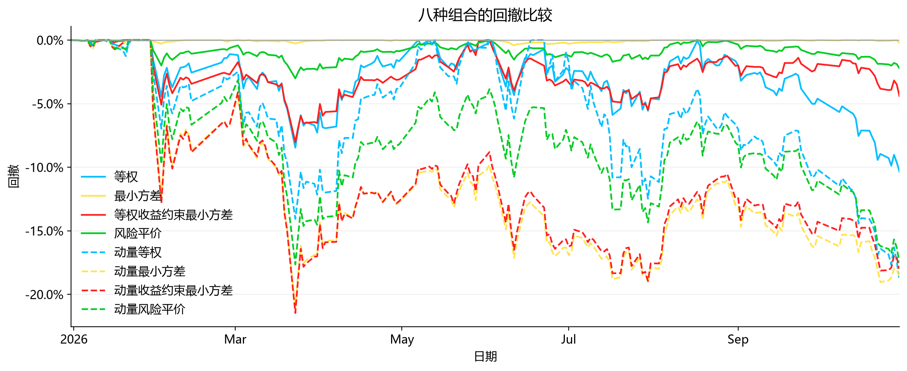
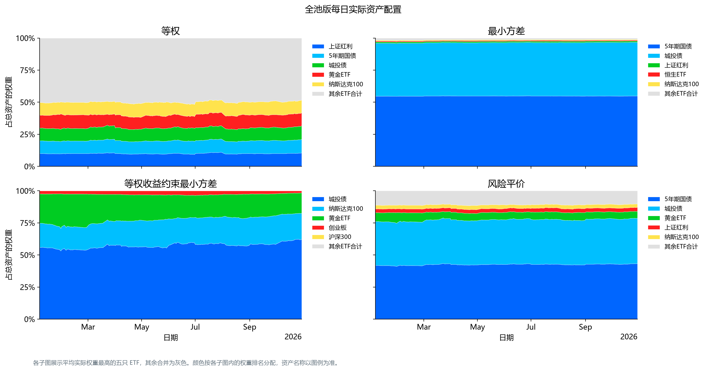
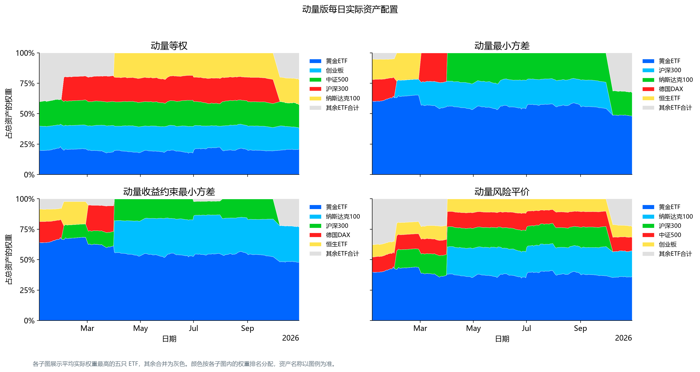
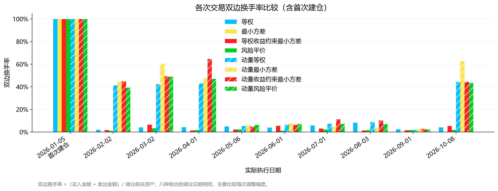
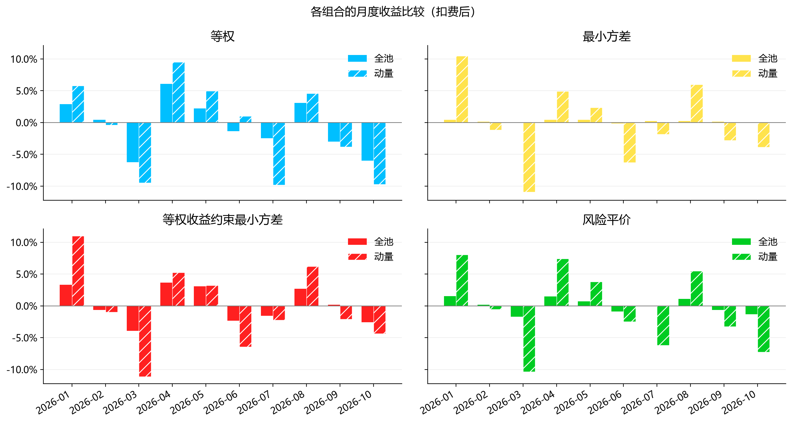
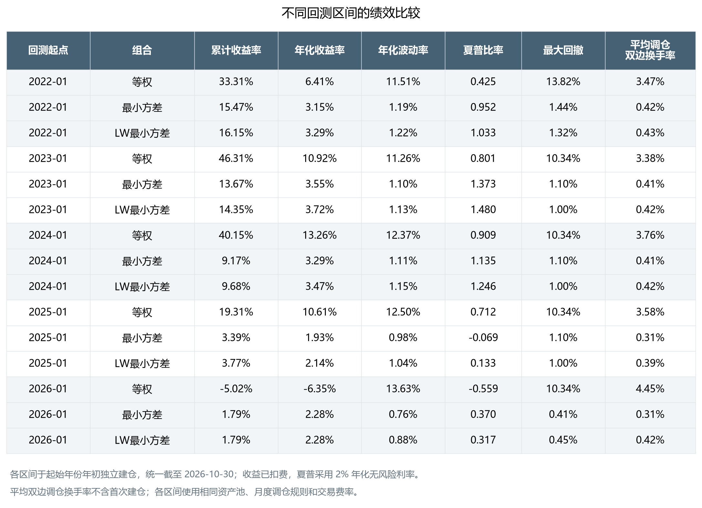
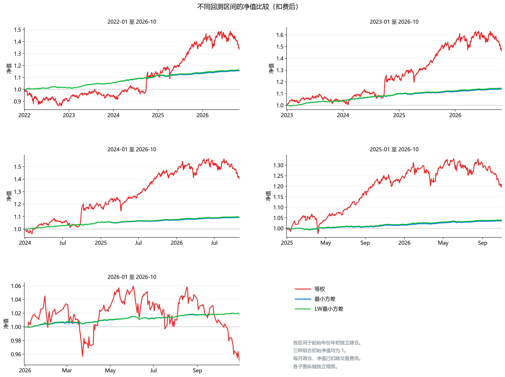
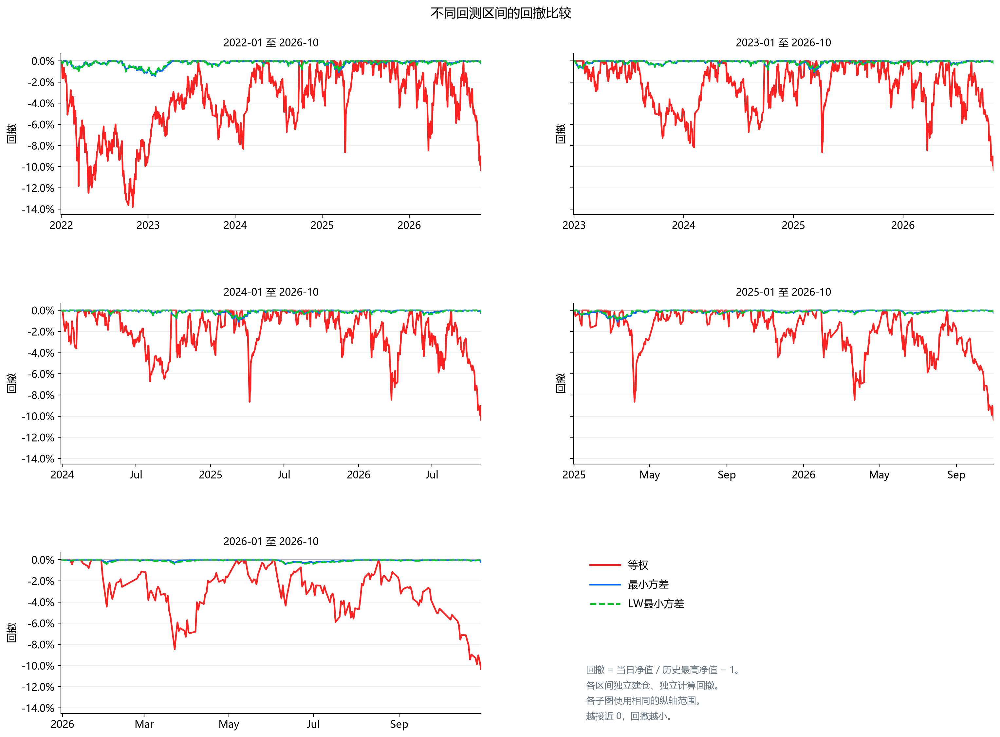

# ETF组合优化与回测

使用 Python 实现ETF数据下载、组合优化、月度调仓回测和结果绘图，比较不同组合构建方法在相同回测条件下的收益与风险表现。根据已有结果，进一步引入 Ledoit–Wolf 协方差收缩估计，比较不同协方差估计方法下最小方差组合的表现，并通过改变回测起点，考察结果在不同回测区间是否稳定。

## 1. 比较的组合

本项目比较八种 ETF 组合，由两种选池方式和四种配权方法交叉构成。每次调仓时，先确定候选 ETF，再在候选池内计算目标权重。所有组合均不做空，调仓目标权重之和为 1。

### 选池方式

- **全池版**：使用资产池中的全部 10 只 ETF。

| 资产类别 | ETF | 代码 | 资产类别 | ETF | 代码 |
| --- | --- | --- | --- | --- | --- |
| A 股 | 沪深 300 | `510300` | 美股 | 纳斯达克 100 | `513100` |
| A 股 | 中证 500 | `510500` | 欧股 | 德国 DAX | `513030` |
| A 股 | 创业板 | `159915` | 债券 | 5 年期国债 | `511010` |
| A 股 | 上证红利 | `510880` | 债券 | 城投债 | `511220` |
| 港股 | 恒生 ETF | `159920` | 黄金 | 黄金 ETF | `518880` |

- **动量版**：在每个信号日，根据截至当日的收盘价计算各 ETF 过去 252 个交易日的累计涨幅，选取涨幅最高的 5 只 ETF。

### 配权方法

| 配权方法 | 构建方式 |
| --- | --- |
| 等权 | 为候选池内的每只 ETF 分配相同的目标权重。 |
| 最小方差 | 根据历史日收益率估计协方差矩阵，选择使组合方差最小的目标权重。 |
| 等权收益约束最小方差 | 以同一候选池中等权组合的估计平均日收益率为下限。在估计收益达到该下限的组合中，选择方差最小的。|
| 风险平价 | 根据估计的协方差矩阵分配权重，使各 ETF 对组合风险的贡献尽量均衡。 |

两个最小方差模型均使用 SciPy 的 SLSQP 方法求解。带收益约束的最小方差组合在全池版中以 10 只 ETF 的等权组合为收益门槛，在动量版中以当期入选的 5 只 ETF 的等权组合为收益门槛。

## 2. 数据与回测方法

### 数据与参数估计

- **数据来源**：行情来自东方财富接口，10 只 ETF 均使用后复权收盘价。
- **资产池**：共 10 只 ETF，覆盖 A 股、港股、美股、欧股、债券和黄金。
- **行情下载区间**：下载起点设为 2010 年 1 月 1 日，截止日为 2026 年 10 月 30 日。各 ETF 从该区间内首个可取得行情的交易日开始记录。
- **参数估计**：采用扩展窗口，每月使用截至信号日的历史数据更新估计。各 ETF 的平均日收益率使用各自的有效日收益样本，任意两只 ETF 的协方差使用两者都有有效日收益的日期估计。若估计的协方差矩阵出现超出数值容差的负特征值，则将其向对角矩阵收缩至半正定。

### 调仓与收益计量

- **样本外回测区间**：2026 年 1 月 5 日至 2026 年 10 月 30 日。首次建仓于 1 月 5 日收盘执行，当日扣除建仓费用，持仓的价格涨跌从 1 月 6 日起计入净值。净值曲线以 2025 年 12 月 31 日的初始净值 1 为基准。
- **信号与执行**：每月最后一个交易日生成调仓信号，使用截至当日的数据计算下一期权重，在下一交易日收盘时执行。
- **持仓与收益**：两次调仓之间持有份额固定，实际权重随价格变动。执行日的价格涨跌由调仓前持仓承担，交易费用在执行日扣除，新持仓从下一交易日起承担价格涨跌。
- **初始资金**：各组合初始资金均为 100,000 元。
- **交易成本**：手续费和滑点统一按 0.05% 的单边综合费率估算，每次交易费用按「买入金额与卖出金额之和 × 0.05%」计算。执行调仓时，通过二分法求解扣除交易费用后的可配置金额，使调仓前总资产等于调仓后持仓市值与交易费用之和（在数值求解容差内）。
- **绩效评价**：夏普比率采用 2% 的年化无风险利率。双边换手率按买卖金额之和除以调仓前总资产计算，平均调仓换手率剔除首次建仓。

八种组合采用相同的数据来源、回测区间、调仓安排和交易费率，以比较不同选池方式与配权方法的表现。

## 3. 文件说明

| 文件 | 用途 |
| --- | --- |
| `download_data.py` | 下载ETF行情并保存数据 |
| `optimization.py` | 计算收益率、估计统计量并求解组合权重 |
| `backtest.py` | 生成调仓计划、执行回测并计算绩效指标 |
| `plot.py` | 调用回测流程，绘制并保存结果图片 |
| `etf_prices.csv` | 合并后的ETF收盘价数据 |
| `figures` | 已生成的回测结果图 |
| `lw_comparison.py` | 估计 LW 协方差，计算对比组合权重，并运行不同起点的独立回测 |

## 4. 运行方法

将代码文件与 `etf_prices.csv` 放在同一个目录下。在项目目录下打开终端，安装回测和绘图所需的依赖：

```bash
python -m pip install -r requirements.txt
```

在项目目录下运行：

```bash
python plot.py
```

程序会读取已有的价格数据，运行原有八种组合实验，以及等权、最小方差和 LW 最小方差在五个回测区间内的对比实验。所有结果图片统一保存在 `figures` 文件夹中。

使用仓库已有的价格数据进行回测时，无需联网或重新下载行情。如需更新数据，可在安装依赖后运行 `python download_data.py`；下载行情需要联网，是否成功取决于接口可用性。

## 5. 回测结果

比较八种组合的累计收益、年化收益、年化波动率、夏普比率、Calmar 比率、最大回撤、换手率与累计交易费用，并结合月度收益和持仓权重，观察不同选池方式与配权方法的表现差异。

### 绩效指标



### 组合净值



### 回撤曲线



### 资产配置





### 换手率



### 资产类别暴露


### 月度收益



## 6. 结果分析

### 6.1 在全池版中比较四种配权方法

- **等权与最小方差**：全池等权每次调仓时给每只 ETF 分配 10% 的目标权重，其中股票类资产的合计目标权重为 70%，债券和黄金分别为 20% 和 10%。全池最小方差则将平均约 96.4% 的资金配置于 5 年期国债和城投债，两只债券 ETF 的权重在回测期间也较为稳定。两者的差异同时体现在持仓结构和净值走势上：全池等权的年化波动率为 13.63%，最大回撤为 10.34%，扣费后累计收益为 −5.02%。全池最小方差的相应指标为 0.76%、0.41% 和 1.79%。在本期，最小方差组合的低波动与较高的债券配置相吻合。
- **收益约束下的最小方差**：在相同的全池内，与无约束版相比，约束版的平均债券权重由 96.4% 降至 57.4%，纳斯达克 100 ETF 和黄金 ETF 的平均权重均接近 20%。约束版的年化波动率从 0.76% 升至 10.41%，最大回撤从 0.41% 升至 8.03%，扣费后累计收益则从 1.79% 降至 1.51%。收益约束为调仓时基于历史数据估计的组合收益设定了下限，但在本次样本外回测中，约束版承担了更大的波动和回撤，最终收益也略低。
- **风险平价**：全池风险平价的平均债券权重约为 77.3%，年化波动率为 4.08%，最大回撤为 3.01%，这三项均介于两种全池最小方差组合之间。它的累计收益为 0.27%，低于两种最小方差组合，高于全池等权。其年化收益率为 0.34%，低于计算夏普比率时采用的 2% 年化无风险利率，夏普比率为 −0.381。与全池等权相比，风险平价在本期降低了波动和回撤。与带收益约束的最小方差相比，风险平价的波动和回撤也更低，但累计收益和夏普比率均较低。

### 6.2 同一种配权方法下比较全池版与动量版

在每组对照中，全池版使用全部 10 只 ETF，动量版在每个信号日按过去 252 个交易日的累计涨幅从高到低排序，选取前 5 只 ETF，再采用与全池版相同的配权方法。下表的变化值按绩效表中的显示值计算，均为「动量版减全池版」。

| 配权方法 | 扣费后累计收益（全池 → 动量） | 累计收益变化 | 年化波动率变化 | 最大回撤变化 |
| --- | ---: | ---: | ---: | ---: |
| 等权 | −5.02% → −9.24% | −4.22 个百分点 | +8.49 个百分点 | +8.56 个百分点 |
| 最小方差 | 1.79% → −4.88% | −6.67 个百分点 | +23.07 个百分点 | +20.62 个百分点 |
| 等权收益约束最小方差 | 1.51% → −3.52% | −5.03 个百分点 | +14.29 个百分点 | +13.44 个百分点 |
| 风险平价 | 0.27% → −7.06% | −7.33 个百分点 | +18.19 个百分点 | +14.64 个百分点 |

- **最小方差组合的持仓变化**：全池版平均将 96.4% 的资金配置于 5 年期国债和城投债，但这两只债券 ETF 在本期各次调仓中均未进入动量候选池。因此，动量版虽然采用相同的最小方差模型，却只能在当期入选的 5 只 ETF 中寻找方差最小的配置。其平均权重最高的资产是黄金 ETF（56.6%），沪深 300 和纳斯达克 100 ETF 合计约占 32.6%。两版的样本外年化波动率分别为 0.76% 和 23.83%，相差 23.07 个百分点，为四组对照中最大。
- **月度表现与回撤**：四种动量组合在 1 月、4 月、5 月和 8 月均跑赢各自的全池版，但 3 月的跌幅均大于对应的全池版，期末累计收益也均落后。其中，动量收益约束最小方差组合的扣费后累计亏损为 3.52%，在动量组中最少，但其净值从前期高点一度回落 21.47%，是动量组中回撤最深的组合。
- **换手率与交易成本**：剔除首次建仓后，四种全池组合的平均双边调仓换手率为 0.31%–4.45%，四种动量组合为 22.34%–26.64%。动量组合的入选名单变化时可能引发持仓更替，从而增加换手率。以最小方差组合为例，动量版累计多支付约 122 元交易费用。

### 6.3 主要结论

在全池版中，最小方差组合的扣费后累计收益最高（1.79%），年化波动率（0.76%）和最大回撤（0.41%）均最低，持仓集中在两只债券 ETF。加入收益约束后，债券权重下降，但本期波动和回撤均上升，扣费后累计收益也略低于无约束版。在相同配权方法下，四种动量组合的扣费后累计收益均低于对应的全池版，年化波动率、最大回撤和平均调仓换手率均更高。其中，最小方差组合的年化波动率差距最大，相差 23.07 个百分点。

## 7. Ledoit–Wolf 扩展实验与回测区间稳定性分析

### 7.1 实验目的

在前述 2026 年回测区间内，全池最小方差组合的累计收益最高，波动率和最大回撤最低，但持仓高度集中于债券。为进一步考察这一结果是否依赖回测区间，并检验协方差估计方法对组合表现的影响，本节引入 Ledoit–Wolf（LW）收缩估计，比较全池等权、原有最小方差和 LW 最小方差三种组合。

以全池等权为基准，比较三种组合的收益和风险，并重点考察 LW 与原有最小方差之间的表现差异。

### 7.2 LW 最小方差

LW 方法将样本协方差矩阵向结构更简单的目标矩阵收缩。本项目使用 `sklearn.covariance.LedoitWolf`，估计形式为：

```math
\widehat{\Sigma}_{LW} = (1-\delta)S + \delta\frac{\mathrm{tr}(S)}{N}I.
```

其中，$`S`$ 为完整收益率样本的经验协方差矩阵，$`N`$ 为资产数量，收缩系数 $`\delta`$ 根据历史样本估计。

LW 最小方差求解：

$$
\begin{aligned}
\min_{w}\quad & w^\top\widehat{\Sigma}_{LW}w,\\
\mathrm{s.t.}\quad & w_i\geq 0,\quad \sum_{i=1}^{N}w_i=1.
\end{aligned}
$$

两种最小方差均调用原有 `min_variance()` 函数，只改变输入的协方差矩阵。每次调仓时，分别使用截至信号日的历史数据重新估计协方差、计算目标权重；LW 的收缩系数也随历史样本更新。

原有方法按任意两只 ETF 的共同有效日期估计协方差；LW 方法则仅使用全部 ETF 均有有效收益率的日期。因此，本实验比较的是两套实际估计流程，表现差异不能全部归因于收缩本身。

### 7.3 回测区间与数据处理

分别从 2022、2023、2024、2025、2026 年年初独立建仓，统一回测至 2026 年 10 月 30 日。首次信号在上一年 12 月最后一个交易日生成，于下一交易日收盘执行。

| 回测起始年份 | 首次执行日 | 结束日期 |
| --- | --- | --- |
| 2022 | 2022-01-04 | 2026-10-30 |
| 2023 | 2023-01-03 | 2026-10-30 |
| 2024 | 2024-01-02 | 2026-10-30 |
| 2025 | 2025-01-02 | 2026-10-30 |
| 2026 | 2026-01-05 | 2026-10-30 |

改变回测起点只改变建仓时间，不改变历史参数估计的起点。每次调仓仍使用数据中截至信号日的全部可用历史，采用扩展窗口更新估计。各区间初始资金均为 100,000 元，沿用前述资产池、月度调仓、持仓漂移、交易成本及绩效计算规则。

现有价格数据在回测期内存在两个孤立缺口：2022 年 1 月 13 日的纳斯达克 100 ETF，以及 2025 年 1 月 23 日的德国 DAX ETF。扩展实验在内存中以前一交易日收盘价填补这两个缺口，原始 CSV 保持不变。该处理使缺失日收益暂记为零，累计价格变化在下一有效交易日体现，也会影响相关日期的日收益率及后续参数估计。

### 7.4 回测结果

#### 绩效指标



#### 净值曲线

各区间分别从初始净值 1 开始，子图纵轴独立缩放。



#### 回撤曲线

各区间独立计算历史净值高点，子图使用相同的纵轴范围。



### 7.5 结果分析

- **等权与最小方差的比较**：在 2022—2025 年起的四个区间内，等权的累计收益均高于两种最小方差，但波动和最大回撤也明显更高。考虑风险后，两种最小方差组合在五个区间中的四个区间取得了更高的夏普比率，仅在 2025 年起的区间落后于等权。因此，最小方差组合在这些区间内表现出较稳定的低波动、低回撤特征，但并不始终具有更高的绝对收益或风险调整后收益。
- **LW 与原有最小方差的比较**：在 2022—2025 年起的四个区间内，LW 的收益和夏普略高，最大回撤略低。在 2026 年起的区间内，两种方法累计收益接近，但 LW 的夏普低于原方法（0.317 对 0.370），最大回撤更高（0.45% 对 0.41%）。此外，LW 在五个区间内的年化波动率均高于原方法。因此，LW 在部分区间改善了收益、夏普和最大回撤，但并未稳定降低样本外波动，也未在所有区间优于原方法。 

综合来看，三种组合表现出不同的收益与风险取舍。原有最小方差的低波动、低回撤特征在这些区间内均有体现；LW 带来的改善较小，且依赖评价指标与回测区间，不能认为其全面优于原方法。

## 8. 回测范围与局限

- **检验范围**：八种组合的完整比较仅覆盖 2026 年不足一年的区间，较长区间的检验只涉及等权和两种最小方差组合。五个扩展区间大量重叠，不能视为五次独立验证；实验也尚未检验资产池变化对结果的影响。
- **比较方法**：原有方法与 LW 使用的有效历史样本不同，表现差异不能完全归因于收缩估计。全池版与动量版同时改变了筛选规则和候选资产数量，当前对照也无法区分两者各自的影响。
- **数据与交易模拟**：两个缺失价格以前一交易日价格填补。交易成本采用固定费率，未模拟最小交易单位、成交量限制及实际成交差异。
