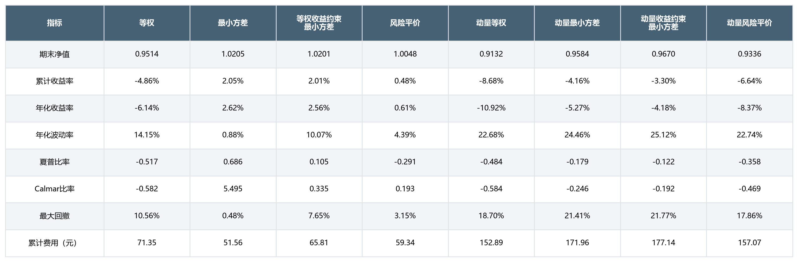
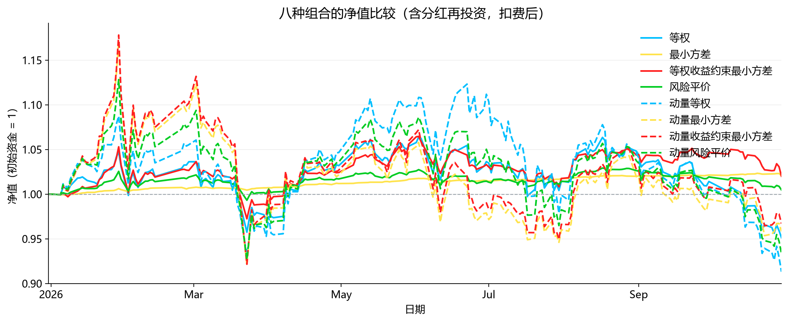
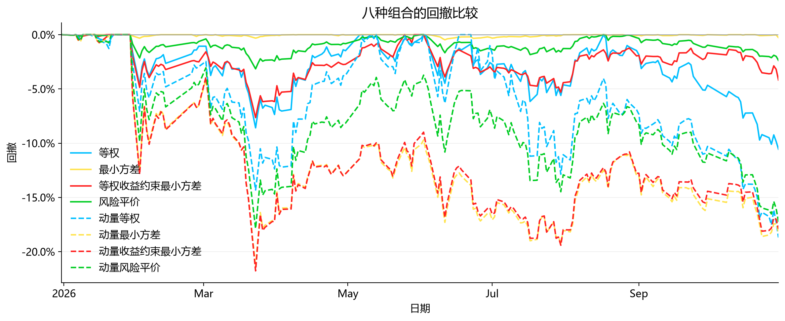
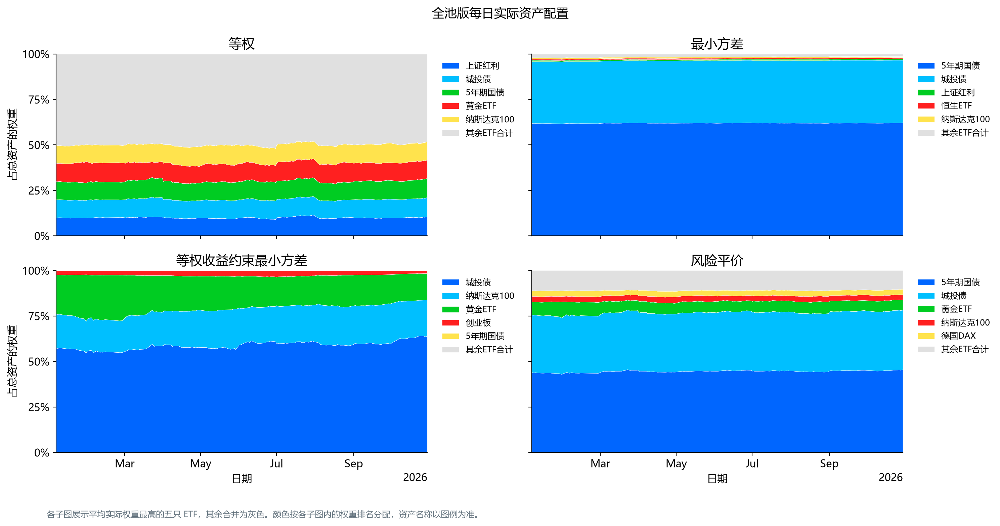
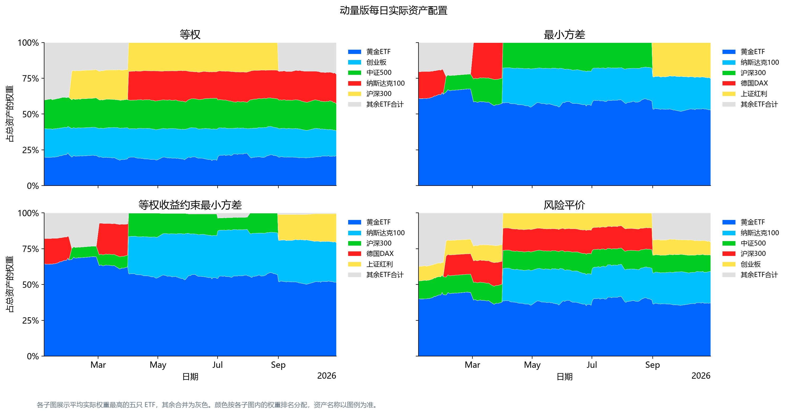
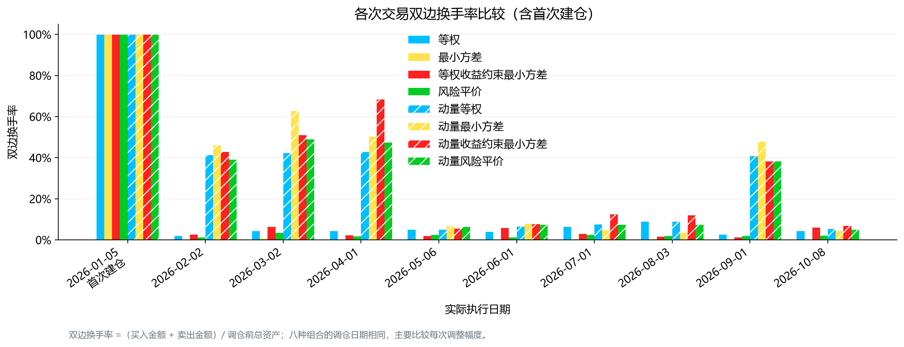
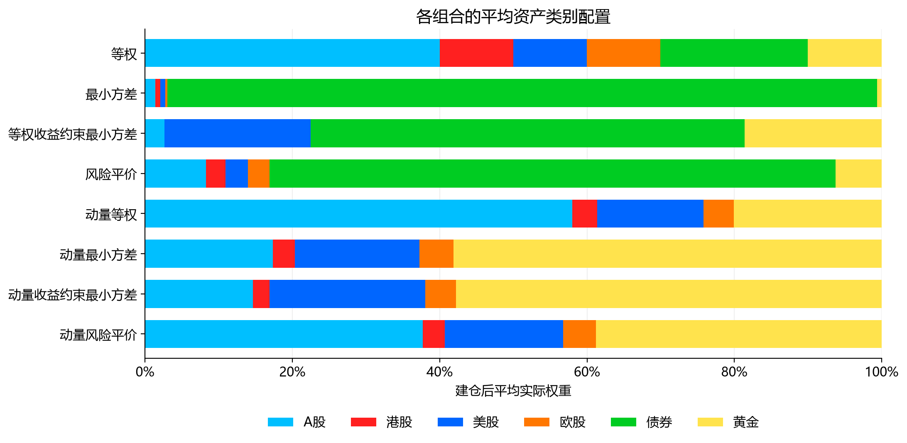
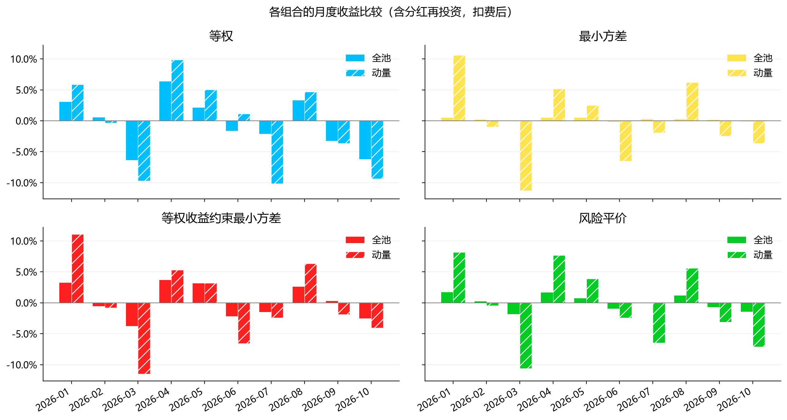
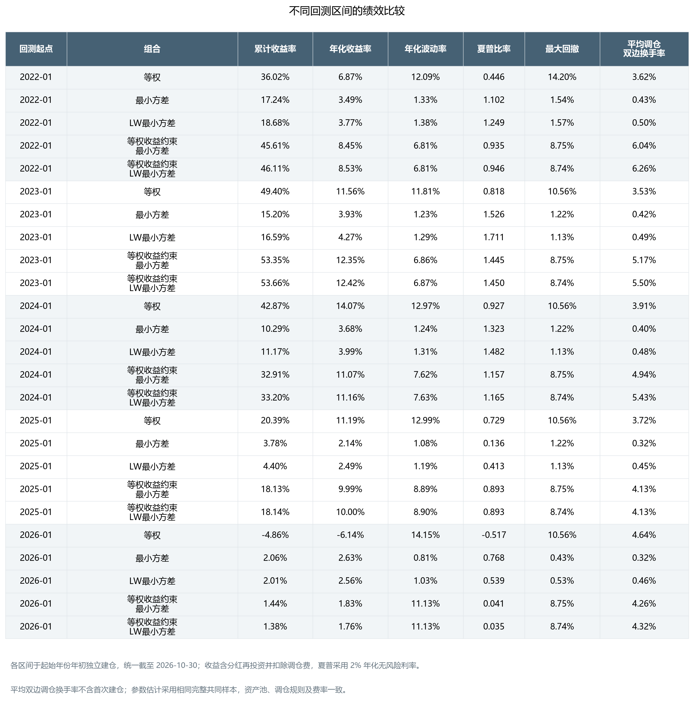
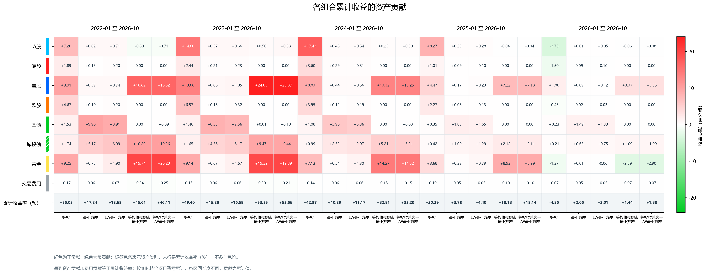

# ETF 组合优化与回测

使用 Python 实现 ETF 数据获取、总回报指数构建、组合优化、月度调仓回测和结果可视化，比较不同选池方式与配权方法的收益、风险和交易成本。

在八种组合的基础实验之外，引入 Ledoit–Wolf（LW）协方差收缩估计，在相同历史样本上比较普通协方差与 LW 协方差，并通过五个回测起点考察结果对回测区间的敏感性。

## 1. 比较的组合

基础实验比较八种 ETF 组合，由两种选池方式和四种配权方法交叉构成。每次调仓时，先确定候选 ETF，再在候选池内计算目标权重。所有组合均不做空，目标权重之和为 1。同一候选池内比较不同配权方法；相同配权方法下比较全池版与动量版时，结果同时反映选池规则及其带来的资产类别暴露变化。

### 选池方式

- **全池版**：使用资产池中的全部 10 只 ETF。
- **动量版**：在每个信号日，根据总回报指数计算过去 252 个交易日的累计收益，选取排名最高的 5 只 ETF。

| 资产类别 | ETF | 代码 | 资产类别 | ETF | 代码 |
| --- | --- | --- | --- | --- | --- |
| A 股 | 沪深 300 | `510300` | 美股 | 纳斯达克 100 | `513100` |
| A 股 | 中证 500 | `510500` | 欧股 | 德国 DAX | `513030` |
| A 股 | 创业板 | `159915` | 债券 | 5 年期国债 | `511010` |
| A 股 | 上证红利 | `510880` | 债券 | 城投债 | `511220` |
| 港股 | 恒生 ETF | `159920` | 黄金 | 黄金 ETF | `518880` |

### 配权方法

| 配权方法 | 构建方式 |
| --- | --- |
| 等权 | 为候选池内的每只 ETF 分配相同目标权重。 |
| 最小方差 | 根据历史日收益率估计协方差矩阵，最小化组合方差。 |
| 等权收益约束最小方差 | 要求组合估计平均日收益率不低于同一候选池的等权组合，在此条件下最小化方差。 |
| 风险平价 | 根据估计的协方差矩阵求解，使各 ETF 的风险贡献占比相等至数值容差。 |

两种最小方差模型均采用 SciPy 的 SLSQP 方法求解。收益约束在全池版中以 10 只 ETF 的等权组合为门槛，在动量版中以当期入选的 5 只 ETF 的等权组合为门槛。收益约束作用于历史估计值，不保证样本外收益高于等权组合。

## 2. 数据与回测方法

### 数据来源与总回报指数

- **行情来源**：腾讯财经历史日线接口，使用不复权收盘价。
- **权益记录**：天天基金披露的现金分红及份额折算记录；已知日期或比例差异依据公告修正，依据保存在事件表中。
- **下载区间**：2010 年 1 月 1 日至 2026 年 10 月 30 日，各 ETF 从区间内首个可取得行情的上市交易日开始记录。
- **收益口径**：结合不复权价格、现金分红和份额折算，构建总回报指数（Total Return Index，TRI），每只 ETF 的首个有效日设为 100。

对于相邻有效报价，设每份旧份额在当期变为 $`s_t`$ 份新份额，并获得现金分红 $`D_t`$，则：

$$
r_t=\frac{s_tP_t+D_t}{P_{t-1}}-1,
\qquad
TRI_t=TRI_{t-1}(1+r_t).
$$

其中，$`P_t`$ 为不复权收盘价。现金分红统一换算为每份旧份额对应的金额，份额折算按价格单位实际生效日对齐。

研究假设为：现金分红在场内除息日按收盘价无成本再投资，允许小数份额，不模拟红利到账延迟、税费及份额折算的整数取整。

收益估计、动量筛选与组合估值统一使用 TRI，不再额外叠加现金分红。

### 参数估计与缺失数据

基础实验采用扩展窗口，每月使用截至信号日的全部可用历史更新参数：

- 每只 ETF 的平均日收益率使用其自身有效样本。
- 任意两只 ETF 的协方差使用两者均有有效日收益的日期。
- 若协方差矩阵出现超出数值容差的负特征值，则向其对角矩阵收缩至半正定。

原始价格及 TRI 的缺失值保留为空，不自动插值。计算日收益时不填补缺失值，因此缺报价日及其后的跨缺口收益不进入日频统计；跨缺口的累计变化仍保留在 TRI 中。

动量排名使用相同起止日期的 TRI 比值，仅允许区间两端均有有效指数的 ETF 参加排名。

### 调仓与收益计量

- **基础实验区间**：2026 年 1 月 5 日至 2026 年 10 月 30 日。
- **净值基准**：各次回测以首次建仓前的信号日净值为 1，建仓日扣除费用，持仓收益从建仓后的下一交易日起计入。
- **信号与执行**：每月最后一个交易日生成信号，使用截至当日的数据计算权重，在下一交易日收盘执行。
- **持仓计量**：调仓间 TRI 模拟单位固定，持仓价值随 TRI 变化，代表包含分红再投资的持有过程；模拟单位不等于真实 ETF 份额。
- **收益归属**：执行日涨跌由旧持仓承担，当日收盘调仓并扣费，新持仓从下一交易日起产生收益。
- **初始资金**：各组合均为 100,000 元。
- **交易成本**：单边综合费率为 0.05%，费用等于买入金额与卖出金额之和乘以费率。调仓时以二分法求解扣费后的可配置金额，使调仓前总资产等于调仓后总资产与费用之和，允许数值容差内的误差。
- **绩效指标**：收益率按实际净值计算，年化采用每年 252 个交易日；夏普比率采用 2% 年化无风险利率。
- **换手率**：双边换手率为买卖金额之和除以调仓前总资产，平均调仓换手率剔除首次建仓。

八种组合使用相同的数据、回测区间、执行安排和交易费率。

## 3. 文件说明

| 文件 | 用途 |
| --- | --- |
| `download_data.py` | 下载不复权行情与权益记录，生成 TRI |
| `optimization.py` | 计算收益率、估计统计量、筛选动量资产并求解权重 |
| `backtest.py` | 生成调仓计划、模拟持仓与费用并计算绩效 |
| `lw_comparison.py` | 使用共同样本比较普通与 LW 协方差，运行不同起点的回测 |
| `plot.py` | 运行基础及扩展实验，绘制并保存图表 |
| `etf_prices.csv` | 不复权收盘价，缺报价保留为空 |
| `etf_actions.csv` | TRI 使用的权益事件，包含来源及已知修正依据 |
| `etf_total_return.csv` | 包含分红再投资及份额折算的总回报指数 |
| `figures/` | 回测结果图 |
| `requirements.txt` | 项目依赖 |

## 4. 运行方法

运行环境：Python 3.10 或更高版本。

将代码文件与数据文件放在同一目录下，安装依赖：

```bash
python -m pip install -r requirements.txt
```

使用已有的 `etf_total_return.csv` 运行回测和绘图：

```bash
python plot.py
```

`plot.py` 为统一入口，自动调用组合优化、基础回测及 LW 扩展实验，结果图片保存至 `figures/`。无需依次运行其他模块，使用已有 TRI 进行回测也无需联网。

如需重新获取数据：

```bash
python download_data.py
```

下载程序生成或覆盖 `etf_prices.csv`、`etf_actions.csv` 和 `etf_total_return.csv`。行情及权益记录全部获取、计算成功后才开始写入文件。下载需要联网，结果受数据接口可用性影响。

## 5. 基础实验图表

### 绩效指标



### 组合净值



### 回撤曲线



### 资产配置





### 换手率



### 资产类别暴露



### 月度收益



## 6. 基础实验结果分析

以下结果对应2026年1月5日至10月30日，不足一个完整年度；基于仓库固定数据快照，收益包含分红再投资并扣除调仓费用。

### 6.1 全池版的收益与风险

| 组合 | 累计收益率 | 年化波动率 | 最大回撤 | 夏普比率 |
| --- | ---: | ---: | ---: | ---: |
| 等权 | −4.86% | 14.15% | 10.56% | −0.517 |
| 最小方差 | 2.05% | 0.88% | 0.48% | 0.686 |
| 等权收益约束最小方差 | 2.01% | 10.07% | 7.65% | 0.105 |
| 风险平价 | 0.48% | 4.39% | 3.15% | −0.291 |

全池最小方差在本区间的累计收益最高，年化波动率仅为0.88%，最大回撤为0.48%。结合资产配置图，其低风险表现与较高的债券权重相吻合。这说明组合通过改变资产配置降低了风险，不能理解为在与等权组合相近的资产暴露下取得了全面改善。

加入等权收益约束后，股票与黄金配置增加，累计收益与普通最小方差接近，但年化波动率升至10.07%，夏普比率由0.686降至0.105。在本区间，提高历史估计收益门槛没有带来更高的实现收益，却对应更大的波动和回撤。

风险平价的波动与回撤介于两种最小方差组合之间，累计收益低于两者。其目标是均衡各ETF的估计风险贡献，而非资金权重，因此仍可能给予低波动的债券ETF较高资金权重。它与最小方差的区别，应结合配置结构和风险贡献理解，不能仅根据是否集中于债券判断。

### 6.2 全池版与动量版

| 配权方法 | 全池累计收益 | 动量累计收益 | 全池年化波动率 | 动量年化波动率 |
| --- | ---: | ---: | ---: | ---: |
| 等权 | −4.86% | −8.68% | 14.15% | 22.68% |
| 最小方差 | 2.05% | −4.16% | 0.88% | 24.46% |
| 等权收益约束最小方差 | 2.01% | −3.30% | 10.07% | 25.12% |
| 风险平价 | 0.48% | −6.64% | 4.39% | 22.74% |

四种动量组合的累计收益均低于对应全池版，波动和最大回撤均更高。两只债券ETF在本区间各次调仓中均未进入动量候选池，使动量最小方差无法保留全池版的债券集中结构。因此，两版差异同时体现了选池规则、候选数量和资产类别暴露的变化，不能全部归因于动量信号本身。

按过去252个交易日累计收益选取前5名，未对波动率或资产类别进行调整。债券未入选是本区间的观察结果，尚不能推广为该规则在所有市场阶段都会排除债券。

剔除首次建仓后，全池组合的平均双边调仓换手率为0.35%—4.64%，动量组合为22.28%—27.20%。以最小方差为例，动量版累计交易费用约172元，全池版约52元；约120元的直接费用差额不足以解释约6211元的期末资产差距，持仓配置及其收益表现也需要结合分析。

## 7. LW 扩展实验与回测区间分析

### 7.1 实验目的与组合

基础实验中的最小方差组合具有明显的债券集中现象。扩展实验考察：

- 低波动、低回撤特征是否在较长区间中仍然存在。
- 加入等权收益约束后，收益与风险如何变化。
- 在相同估计样本上，LW 收缩对组合表现有何影响。

LW收缩用于改善协方差估计，不直接约束债券权重，也不保证消除持仓集中。本实验关注相同样本下协方差估计方法的变化，不将LW视为提高收益或降低样本外风险的保证。

扩展实验比较以下五种全池组合：

- 等权
- 最小方差
- LW最小方差
- 等权收益约束最小方差
- 等权收益约束LW最小方差

### 7.2 协方差估计与共同样本

LW 使用 `sklearn.covariance.LedoitWolf`，将经验协方差向单位矩阵的缩放形式收缩：

$$
\widehat{\Sigma}_{LW}
=(1-\delta)S_{\mathrm{emp}}
+\delta\frac{\mathrm{tr}(S_{\mathrm{emp}})}{N}I.
$$

其中，$`S_{\mathrm{emp}}`$ 为完整共同收益样本的经验协方差矩阵，$`N`$ 为资产数量，$`\delta`$ 为根据历史样本估计的收缩系数，$`I`$ 为单位矩阵，$`\mathrm{tr}`$ 表示矩阵的迹。

普通与 LW 最小方差使用相同优化函数，仅替换协方差输入；两种收益约束组合使用相同均值和等权收益门槛。

样本处理规则：

- 扩展实验仅保留十只ETF均有有效日收益的日期，用于统一估计均值、普通协方差和LW协方差；等权组合本身不需要估计这些参数。
- 基础与扩展实验均从2010年开始查询历史，但基础实验保留各资产及资产对各自的有效样本，扩展实验统一使用完整共同样本，因此同名组合的权重和结果可能不同。
- 普通协方差采用样本数量减一作分母，LW内部经验协方差采用样本数量作分母。单纯将协方差整体乘以正常数，不改变本项目两类最小方差模型的最优权重；LW收缩还会改变矩阵结构，因而可能改变配置。

### 7.3 回测区间与停牌估值

分别从五个年份年初独立建仓，统一回测至 2026 年 10 月 30 日：

| 起始年份 | 首次执行日 | 结束日期 |
| --- | --- | --- |
| 2022 | 2022-01-04 | 2026-10-30 |
| 2023 | 2023-01-03 | 2026-10-30 |
| 2024 | 2024-01-02 | 2026-10-30 |
| 2025 | 2025-01-02 | 2026-10-30 |
| 2026 | 2026-01-05 | 2026-10-30 |

改变回测起点只改变首次建仓时间，不按建仓日截断历史估计数据。每次调仓仍使用截至信号日的扩展窗口，共同样本也随之更新。

对已确认停牌的纳斯达克 100 ETF（2022-01-13）和德国 DAX ETF（2025-01-23），仅在持仓估值副本中沿用上一有效 TRI，下一有效报价体现累计变化。

该处理不修改原始 CSV，也不填补参数估计样本；代码禁止在这两个停牌日执行调仓。其他原因不明的持仓缺报价会触发报错。

### 7.4 绩效与收益贡献





收益贡献按实际持仓逐日计算。设 $`q_{i,t-1}`$ 为资产 $`i`$ 在前一日收盘后的 TRI 模拟单位，$`V_0`$ 为初始资金，则资产贡献为：

$$
C_i=\frac{\sum_t q_{i,t-1}(TRI_{i,t}-TRI_{i,t-1})}{V_0}.
$$

设 $`F_t`$ 为当日交易费用，则费用贡献为：

$$
C_{\mathrm{费用}}=-\frac{\sum_t F_t}{V_0}.
$$

设 $`V_T`$ 为期末总资产，在无外部资金流入流出的条件下：

$$
\sum_i C_i+C_{\mathrm{费用}}=\frac{V_T}{V_0}-1.
$$

上述贡献以小数表示，绘图时乘以100并以百分点展示。正贡献为红色，负贡献为绿色；交易费用单独列示，末行显示扣费后的累计收益率。国债与城投债分别展示，以观察低风险组合的收益来源。

贡献由逐日持仓盈亏累计得到，包含权重漂移和再投资的影响；不使用平均权重乘以区间收益。不同起点的区间长度不同，累计贡献不能直接作为年化表现比较。

### 7.5 结果分析

- **等权与无收益约束最小方差**：2022—2025年起的四个区间内，等权累计收益高于普通及LW最小方差，但波动和最大回撤也更高。2026年起的区间，收益排序反转，两种最小方差均优于等权。夏普比率方面，两种最小方差在五个区间中的四个高于等权，2025年起的区间例外。
- **收益约束与无收益约束**：相对于各自无收益约束的版本，两种收益约束组合在2022—2025年起的区间累计收益更高，在2026年起的区间更低；五个区间的波动和最大回撤均更高。
- **收益约束组合与等权**：两种收益约束组合在2022—2024年及2026年起的区间累计收益高于等权，在2025年起的区间低于等权。
- **LW的作用**：在无收益约束的最小方差组合中，LW在2022—2025年起的区间提高了累计收益与夏普，在2026年起的区间两项均较低。五个区间内LW的年化波动率均更高，最大回撤也并非始终降低。
- **收益约束下的LW**：相比普通收益约束组合，LW在2022—2025年起的区间累计收益略高，在2026年起的区间略低，差异整体较小。

总体来看，无收益约束的最小方差组合在这些区间内保持了较低的波动和回撤；收益约束带来了更高风险，其收益改善取决于回测区间。LW的影响相对较小，未表现出全面优势。五个区间高度重叠，上述结果用于描述起点敏感性，不构成五次独立验证。

## 8. 回测范围与局限

- **样本范围**：八组合比较仅覆盖2026年不足一年的区间；长区间实验涉及五种全池组合，尚未扩展至动量及风险平价。
- **区间重叠**：五个扩展区间大量重叠，不能视为五次独立验证，也不构成独立的统计显著性证据。
- **资产池选择**：采用固定资产池，尚未检验资产池变化、筛选偏差及参数选择对结果的影响。
- **比较边界**：基础与扩展实验的有效样本规则不同；全池与动量对照同时改变了筛选规则和候选数量，无法单独识别两者影响。
- **数据质量**：权益记录及行情依赖第三方来源。已知差异有显式修正依据，但未声称全部历史记录均完成独立公告核验。
- **估计误差**：历史均值与协方差并不代表未来参数。主实验采用不同有效日期的估计，也可能受到资产历史长度和市场阶段差异影响。
- **交易模拟**：采用收盘成交、固定综合费率及小数模拟单位，未模拟最小交易单位、成交量限制、真实成交价格和红利到账延迟。
- **停牌估值**：对两个已确认停牌日采用上一 TRI 估值，可能影响日度波动与回撤的时间分布；这不代表停牌期间可以成交。

本项目用于展示数据处理、组合优化、账户记账及实验分析流程，回测结果不代表未来收益。
