# ETF组合优化与回测

使用 Python 实现ETF数据下载、组合优化、月度调仓回测和结果绘图，比较不同组合构建方法在相同回测条件下的收益与风险表现。

## 1. 比较的组合

本项目比较八种 ETF 组合，由两种选池方式和四种配权方法交叉构成。每次调仓时，先确定候选 ETF，再在候选池内计算目标权重。所有组合均不做空，调仓目标权重之和为 1。

### 选池方式

- **全池版**：使用资产池中的全部 10 只 ETF。

| 资产类别 | ETF | 代码 | 资产类别 | ETF | 代码 |
| --- | --- | --- | --- | --- | --- |
| A 股 | 沪深 300 | `510300` | 美股 | 纳斯达克 100 | `513100` |
| A 股 | 中证 500 | `510500` | 欧股 | 德国 DAX | `513030` |
| A 股 | 创业板 | `159915` | 债券 | 5 年期国债 | `511010` |
| A 股 | 上证红利 | `510880` | 债券 | 城投债 | `511220` |
| 港股 | 恒生 ETF | `159920` | 黄金 | 黄金 ETF | `518880` |
- **动量版**：在每个信号日，根据截至当日的收盘价计算各 ETF 过去 126 个交易日的累计涨幅，选取涨幅最高的 5 只 ETF。

### 配权方法

| 配权方法 | 构建方式 |
| --- | --- |
| 等权 | 为候选池内的每只 ETF 分配相同的目标权重。 |
| 最小方差 | 根据历史日收益率估计协方差矩阵，选择使组合方差最小的目标权重。 |
| 带收益约束的最小方差 | 在组合的估计平均日收益率不低于当前候选池等权组合的估计平均日收益率的条件下，最小化组合方差。 |
| 风险平价 | 根据估计的协方差矩阵分配权重，使各 ETF 对组合风险的贡献尽量均衡。 |

两个最小方差模型均使用 SciPy 的 SLSQP 方法求解。带收益约束的最小方差组合在全池版中以 10 只 ETF 的等权组合为收益门槛，在动量版中以当期入选的 5 只 ETF 的等权组合为收益门槛。

## 2. 数据与回测方法

### 数据与参数估计

- **数据来源**：行情来自东方财富接口，10 只 ETF 均使用后复权收盘价。
- **资产池**：共 10 只 ETF，覆盖 A 股、港股、美股、欧股、债券和黄金。
- **行情下载区间**：下载起点设为 2010 年 1 月 1 日，截止日为 2026 年 10 月 30 日。各 ETF 从该区间内首个可取得行情的交易日开始记录。
- **参数估计**：采用扩展窗口，每月使用截至信号日的历史数据更新估计。各 ETF 的平均日收益率使用各自的有效日收益样本，任意两只 ETF 的协方差使用两者都有有效日收益的日期估计。若估计的协方差矩阵出现超出数值容差的负特征值，则将其向对角矩阵收缩至半正定。

### 调仓与收益计量

- **样本外回测区间**：2026 年 1 月 5 日至 2026 年 10 月 30 日。首次建仓于 1 月 5 日收盘执行，当日扣除建仓费用，持仓的价格涨跌从 1 月 6 日起计入净值。净值曲线以 2025 年 12 月 31 日的初始净值 1 为基准。
- **信号与执行**：每月最后一个交易日生成调仓信号，使用截至当日的数据计算下一期权重，在下一交易日收盘时执行。
- **持仓与收益**：两次调仓之间持有份额固定，实际权重随价格变动。执行日的价格涨跌由调仓前持仓承担，交易费用在执行日扣除，新持仓从下一交易日起承担价格涨跌。
- **初始资金**：各组合初始资金均为 100,000 元。
- **交易成本**：单边费率为 0.05%，每次交易费用按「买入金额与卖出金额之和 × 0.05%」计算。执行调仓时，通过二分法求解扣除交易费用后的可配置金额，使调仓前总资产等于调仓后持仓市值与交易费用之和（在数值求解容差内）。
- **绩效评价**：夏普比率采用 2% 的年化无风险利率。双边换手率按买卖金额之和除以调仓前总资产计算，平均调仓换手率剔除首次建仓。

八种组合采用相同的数据来源、回测区间、调仓安排和交易费率，以比较不同选池方式与配权方法的表现。

## 3. 文件说明

| 文件 | 用途 |
| --- | --- |
| `download_data.py` | 下载ETF行情并整理价格数据 |
| `optimization.py` | 计算收益率、估计统计量并求解组合权重 |
| `backtest.py` | 生成调仓计划、执行回测并计算绩效指标 |
| `plot.py` | 调用回测流程，绘制并保存结果图片 |
| `etf_prices.csv` | 合并后的ETF收盘价数据 |
| 各个 `.png` 文件 | 已生成的回测结果图 |

## 4. 运行方法

将代码文件与 `etf_prices.csv` 放在同一个目录下。

在项目目录下打开终端，安装回测和绘图所需的依赖：

```bash
python -m pip install -r requirements.txt
```

在项目目录下运行：

```bash
python plot.py
```

程序会读取已有的价格数据，计算八种组合的目标权重，运行回测并绘制结果。新生成的图片保存在 `figures` 文件夹中。

使用仓库已有的价格数据进行回测时，无需联网或重新下载行情。如需更新数据，可在安装依赖后运行 `python download_data.py`；下载行情需要联网，是否成功取决于接口可用性。

## 5. 回测结果

比较八种组合的累计收益、年化收益、年化波动率、夏普比率、Calmar 比率、最大回撤、换手率与累计交易费用，并结合月度收益和持仓权重，观察不同选池方式与配权方法的表现差异。

### 绩效指标

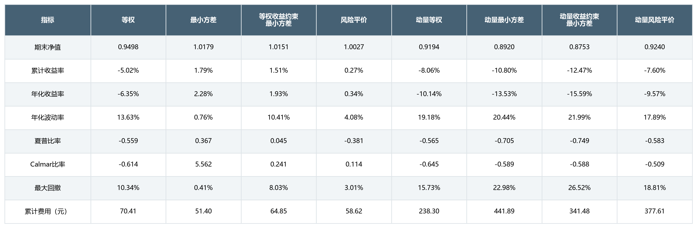

### 组合净值

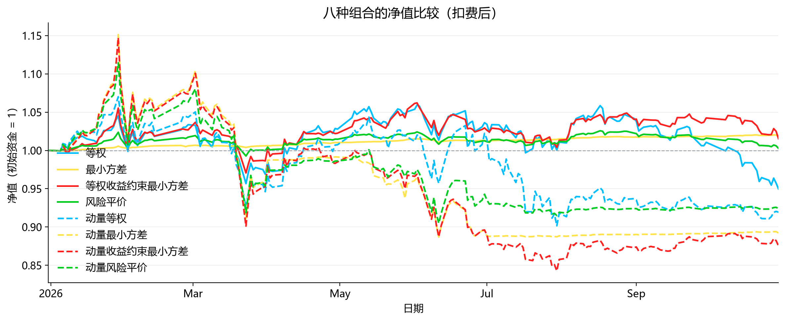

### 回撤曲线

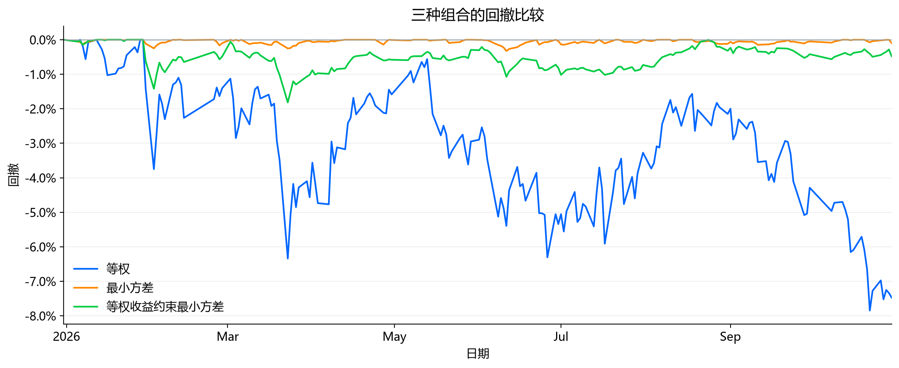

### 资产配置

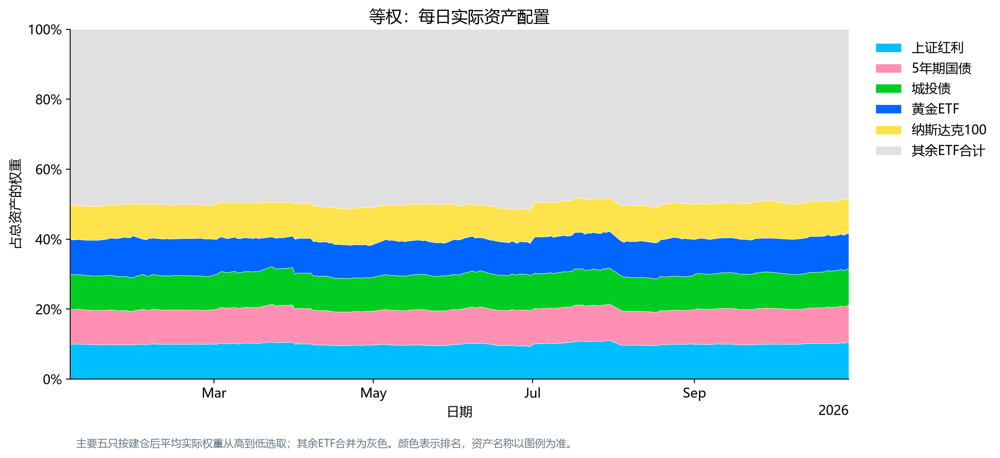

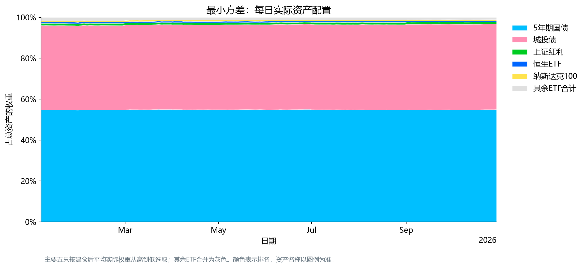

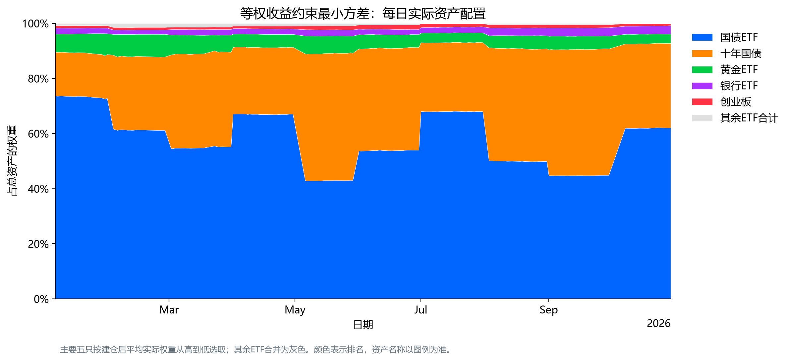

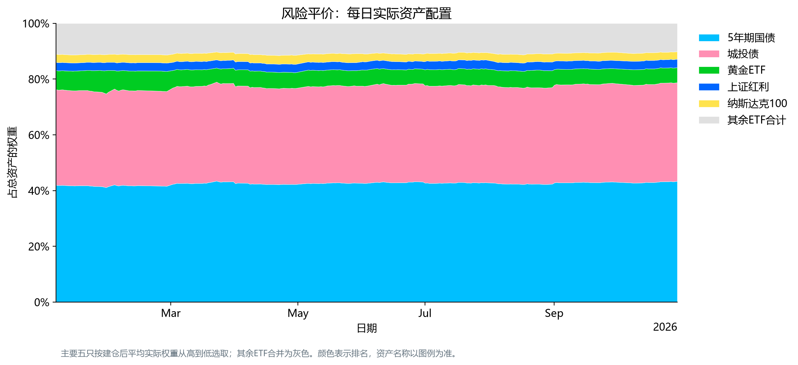

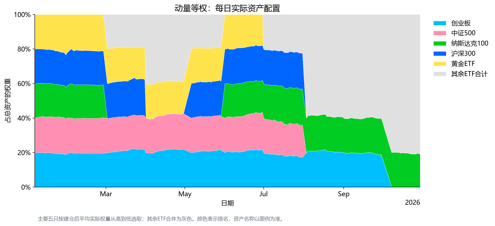

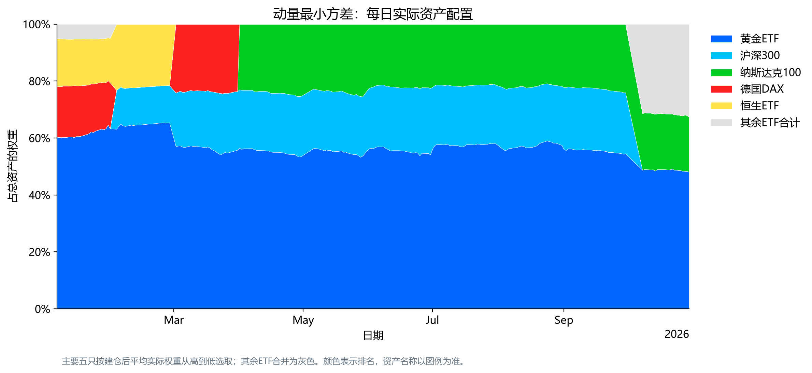

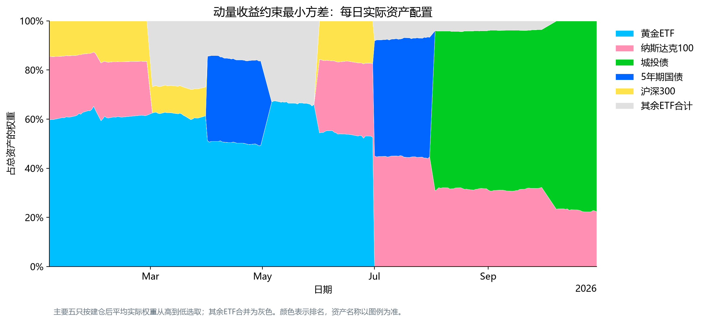

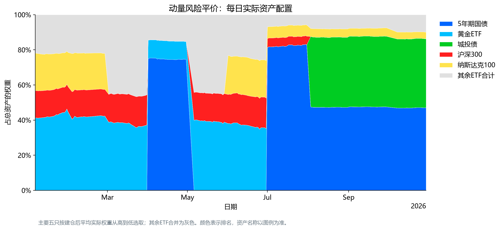

### 换手率

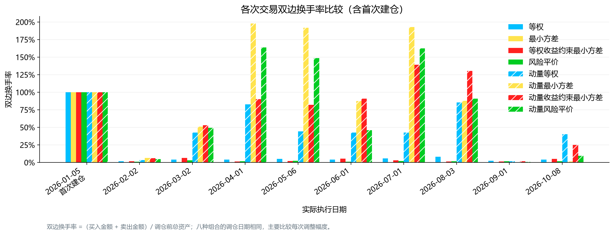

### 资产类别暴露

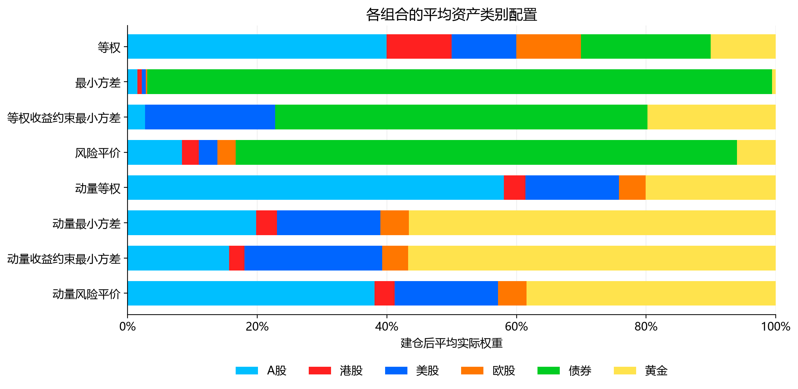

### 月度收益


## 6. 结果分析

### 收益与风险比较

在当前样本外回测中，最小方差组合的累计收益率为1.94%，高于等权组合的−4.66%和带收益约束的最小方差组合的1.49%。其年化波动率和最大回撤分别为0.82%和0.33%，均为三种组合中最低，夏普比率为0.568，也高于另外两种组合。

带收益约束的最小方差组合年化波动率为2.46%，最大回撤为1.82%，风险水平介于另外两种组合之间。加入历史估计收益约束后，该组合并未在本测试期内取得更高的样本外收益。

### 净值与回撤表现

等权组合在测试期内曾出现阶段性上涨，部分时点的净值高于另外两种组合，但优势未能持续，随后出现较大回落，期末净值为0.9534，最大回撤达到7.85%。

最小方差组合净值整体较为平稳，期末净值达到1.0194，最大回撤为0.33%。带收益约束的最小方差组合期末净值为1.0149，最大回撤为1.82%。两种优化组合在本测试期内均表现出较低的波动和回撤。

### 资产配置差异

等权组合虽然对单只ETF采用相同的目标权重，但资产类别之间并不均衡。14只ETF中有11只为股票类，股票类资产的合计目标权重达到78.57%，因此组合整体偏向股票资产。这可能是其波动和回撤较大的重要原因，但各类资产对收益的具体影响还需要进一步进行收益贡献分析。

最小方差组合长期将超过90%的资金配置于国债ETF，其他ETF占比较小。这一配置与其较低的样本外波动和回撤相吻合，也说明当前未设置单只ETF权重上限的模型允许出现较高的持仓集中度。

加入收益约束后，组合仍以债券ETF为主，但国债ETF与十年国债之间的配置比例变化更明显，同时持有少量黄金及其他ETF。相较于无收益约束的最小方差组合，其配置有所分散，但仍主要集中于债券类资产。

### 换手率与交易成本

三种组合采用相同的月度调仓计划，但交易幅度不同。带收益约束的最小方差组合换手率最高，与其债券ETF配置比例的较大变化相吻合；等权组合主要进行小幅调整，最小方差组合调整幅度最小。

带收益约束的最小方差组合累计交易费用为174.00元，高于等权组合的67.06元和最小方差组合的52.20元。不过，不能将两种优化组合的收益差距全部归因于交易成本，因为它们的持仓结构和持仓收益也存在差异。

### 主要结论

在当前资产池和测试区间内，最小方差组合通过高度偏向国债ETF的配置，取得了最低的波动、最大回撤和交易费用，以及最高的扣费后累计收益。

加入历史估计收益约束后，组合进行了更明显的配置调整，但未获得更高的样本外收益，同时增加了风险和交易费用。历史估计收益约束并不能保证样本外收益高于等权组合。

这些结果反映了三种组合在当前ETF池和测试区间内的差异，尚不能据此认定某种组合在其他市场阶段也始终更优。

## 7. 回测范围与局限

本项目结果对应当前选定的ETF池、历史区间和交易成本假设。样本外回测时间较短，不同组合的表现仍需在更长时间及不同市场阶段下进一步比较。

回测采用收盘价成交和简化交易成本模型，未模拟最小交易单位、成交量限制等实际交易细节。
